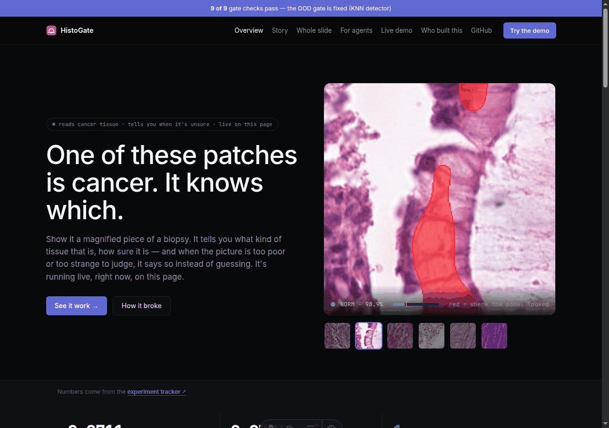
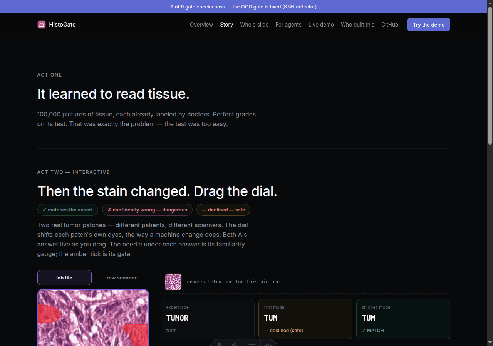
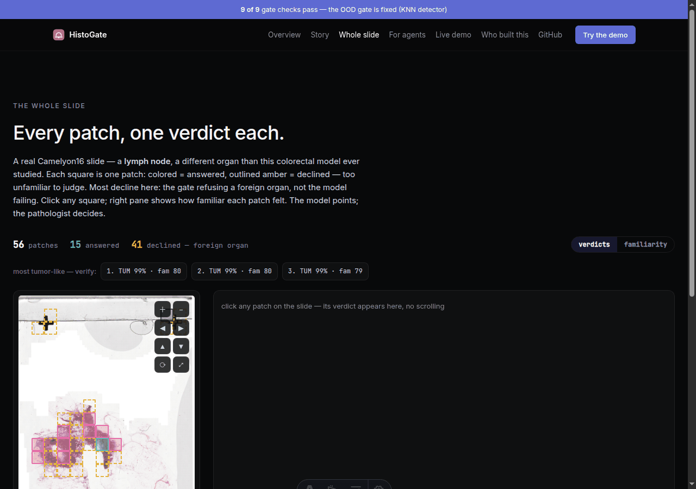
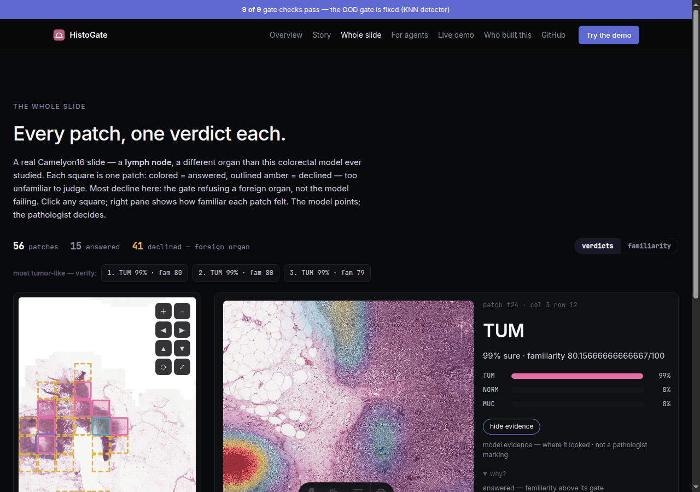
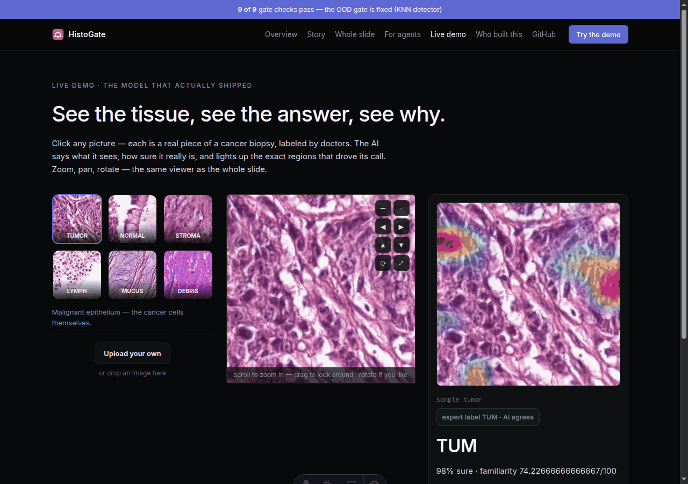
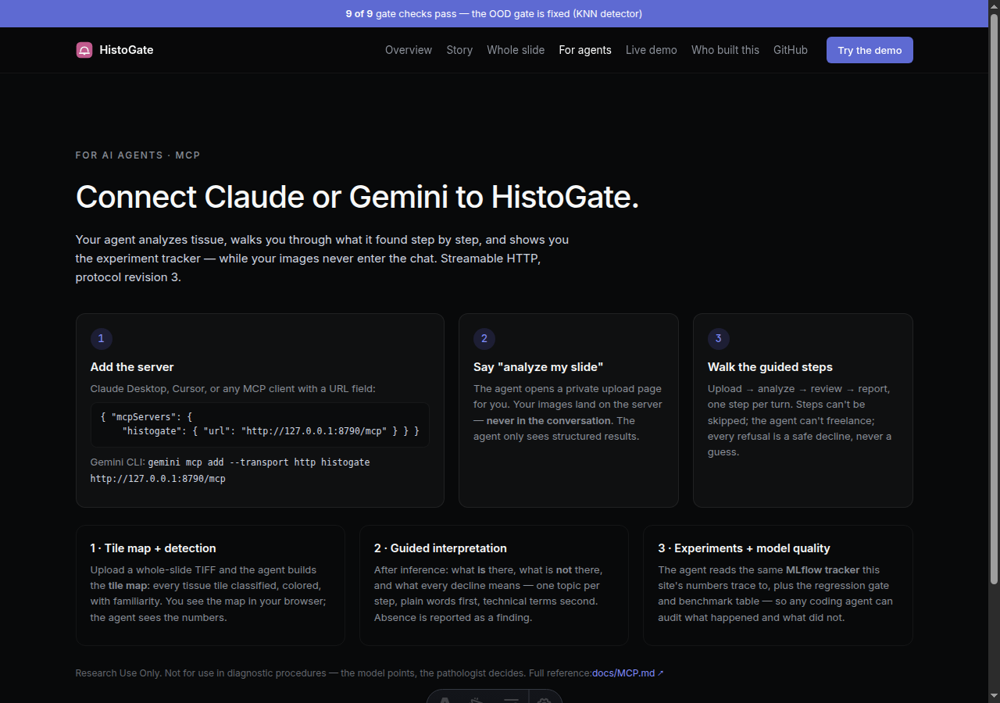
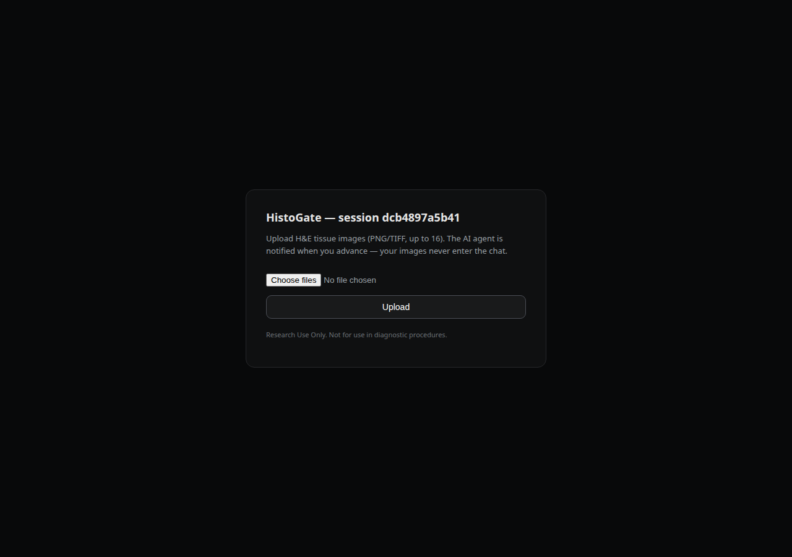
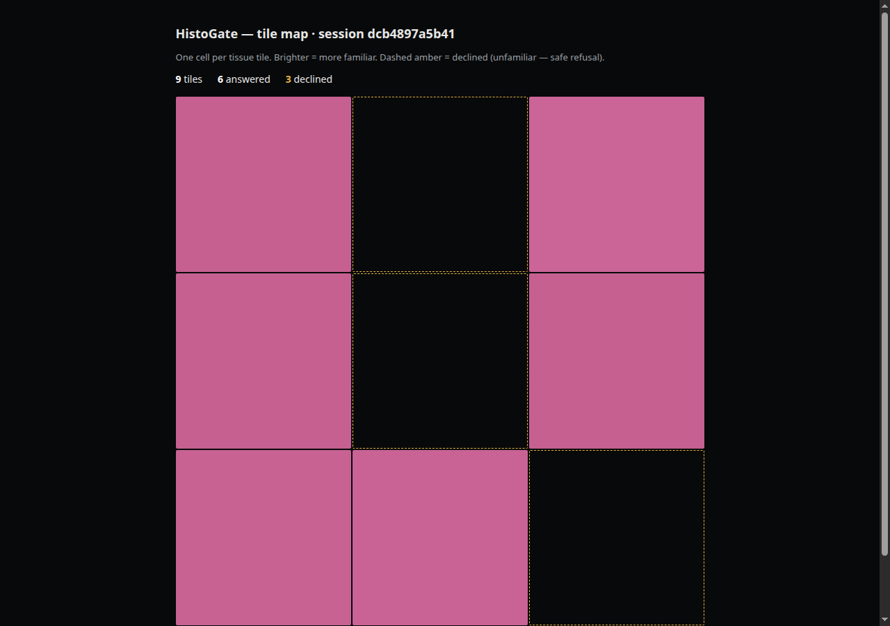
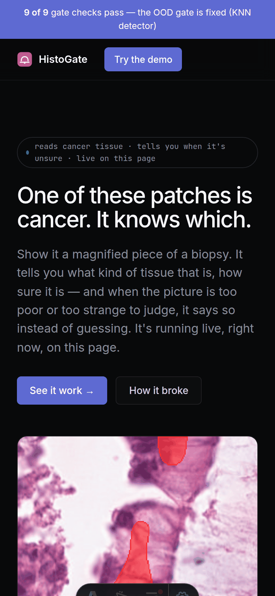

# HistoGate

Stain-invariant, quality-gated 9-class colorectal H&E tissue classifier
with TSR/TIL biomarkers, attention-MIL slide reporting, ONNX fp16/int8
export, a fail-closed regression gate, and FastAPI/FastMCP serving.

**Numbers → [docs/RESULTS.md](docs/RESULTS.md)** · rendered from measured
artifacts, never typed by hand; CI enforces byte-parity.

## The user flow, as screenshots

From landing to agent-assisted analysis — every state below is real (local
dev server, live model):

| | | |
|---|---|---|
|  |  |  |
| **1 · land** — the offer, one screen | **2 · the story** — five acts, artifacts linked | **3 · whole slide** — 56 patches, verdicts + declines |
|  |  |  |
| **4 · inspect a tile** — full-res tile, verdict, Grad-CAM evidence | **5 · try it** — upload your own patch, get the verdict | **6 · for agents** — connect Claude/Gemini over MCP |
|  |  |  |
| **7 · agent opens a portal** — images never enter the chat | **8 · tile map returned** — every tile classified, seen in browser | **9 · on a phone** — same flow, responsive |

## Why this repo exists

Not the accuracy — the **diagnostic loop**. The model passed every expected
test, failed the gate check built to catch it, and every fix since has been
measured, not assumed. Five acts, each backed by artifacts:
**[docs/STORY.md](docs/STORY.md)**.

## Results (all in [docs/RESULTS.md](docs/RESULTS.md))

External CRC-VAL macro-F1 and kappa · raw multi-scanner domain score ·
calibration error · OOD KNN AUROC · int8 biomarker drift ·
throughput / VRAM · per-run history with two documented gate failures.

## Quickstart

```bash
git clone <repo> && cd histogate
uv sync
uv run pytest -q                                # CPU test suite
bash scripts/morning_eval.sh runs/<run-name>    # full measurement battery
uv run histogate-gate --metrics <gate_inputs.json> --out gate_report.json
```

Datasets (not redistributed): NCT-CRC-HE-100K + NONORM (zenodo 1214456),
CRC-VAL-HE-7K under `data/raw/`.

## Honest failures (documented, not hidden)

| Check | Verdict | One-line reading |
|---|---|---|
| Domain drop | **CLOSED by PR-16** | normalized-training collapse; recovered, then closed by mixed training + calibrated stain augmentation — the mixed model now scores higher on raw scanners than on the cleaned set |
| OOD AUROC | PASS | KNN feature-space detector (Sun et al. 2022), 0.9763 live-path vs Camelyon16 — energy was 0.7972 |
| int8 argmax | **CLOSED by PR-16** | earlier runs flipped a fraction of patch labels (biomarker drift always zero); the mixed model's int8 argmax agreement is perfect |

Exact values: [docs/RESULTS.md](docs/RESULTS.md).

## Layout

```
src/histogate/   model (ConvNeXt-Tiny, AttentionMIL), data, bio_optics,
                 stainaug, calibration, biomarkers, export/onnx, gates,
                 serve/{api,mcp}
scripts/         launch_*.sh, morning_eval.sh, eval_* , next_step.py
docs/            STORY.md, RESULTS.md, ROADMAP_PR15-20.md, EXEC_ENGINE.md
tests/           adversarial suite (stain physics, wiring, gate, serve)
```

## Reproducing every number

`bash scripts/morning_eval.sh runs/<name>` reruns external eval,
calibration, domain, OOD, ONNX export+bench, int8 drift, and the nine-check
gate. Roadmap execution is a crash-recoverable step loop
([docs/EXEC_ENGINE.md](docs/EXEC_ENGINE.md)): `uv run python
scripts/next_step.py` reports the next sub-task and its pass criterion.

## License / use

Research use only. NCT-CRC-HE-100K licensing applies to the data.
